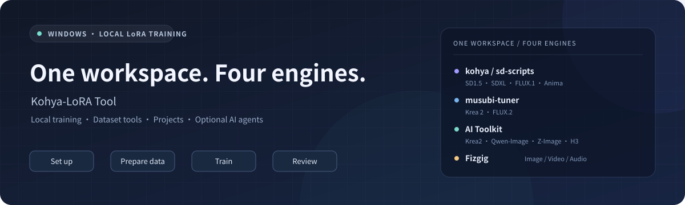

<p align="center">
  
</p>

<h1 align="center">Kohya-LoRA Tool</h1>

<p align="center"><strong>A Windows workspace for local LoRA training.</strong></p>

<p align="center">
  <a href="https://github.com/l1934332574-maker/Kohya-LoRA-Tool/releases/latest"></a>
  
  <a href="LICENSE"></a>
</p>

<p align="center">
  <strong>English</strong> · <a href="README.zh-CN.md">简体中文</a><br />
  <a href="https://github.com/l1934332574-maker/Kohya-LoRA-Tool/releases/latest">Download</a> ·
  <a href="https://modelscope.cn/models/FGtiancai/Kohya-LoRA-Tool">China mirror</a> ·
  <a href="CHANGELOG.md">Changelog</a> ·
  <a href="https://github.com/l1934332574-maker/Kohya-LoRA-Tool/issues">Issues</a>
</p>

Train character, style and concept LoRAs through a single desktop workflow: environment setup, model selection, dataset preparation, training and sample review. Integrates **kohya / sd-scripts, musubi-tuner, AI Toolkit and Fizgig**, with additional video and audio modes for supported models.

**Platform:** Windows 10 / 11. **Interface language:** primarily Simplified Chinese. NVIDIA is the primary supported GPU path; AMD support is available through selected Fizgig ROCm configurations and depends on the model and hardware.

## Features

| Capability | What it provides |
| --- | --- |
| **Model-first workflow** | Choose a model and version, then review engine recommendations for your hardware. |
| **Environment and model management** | Guided setup and repair, domestic download sources, resumable downloads and reuse of local model files. |
| **Dataset preparation** | WD14 / PixAI tagging, caption editing and project-specific data preparation. A separate image-to-prompt tool also offers RAM++ photo tags and Qwen3-VL descriptions. |
| **Training controls** | Six task-oriented presets with parameter previews, manual overrides, project settings and training records. |
| **Sample review** | Fixed-seed previews, sampling history and A/B comparisons where supported by the selected mode. |
| **Agent integration** | An optional in-app assistant and an authenticated local MCP interface for external agents. |
| **Concept sliders** | Experimental text-guided or image-pair training with weight comparisons for supported SDXL and Anima models. |

## Model and engine support

| Engine | Integrated models | Media |
| --- | --- | --- |
| **kohya / sd-scripts** | SD 1.5, SDXL, FLUX.1, Anima | Images |
| **musubi-tuner** | Krea 2, FLUX.2 | Images |
| **AI Toolkit** | Krea 2, Qwen-Image, Z-Image Base, MiniMax H3 | Images; H3 video |
| **Fizgig** | Krea 2, FLUX.2 Klein 9B, Qwen-Image-2.1, Z-Image Turbo, MiniMax H3; experimental SDXL and standard Anima | Images; H3 image / video / audio |

Capabilities vary by model, engine version and configuration. Klein 4B uses the Musubi route; Anima 2.9B / 40-layer models use the Kohya route. Third-party checkpoints must match the supported architecture. VRAM requirements and preview availability depend on the selected mode.

## Get started

1. Download **`Setup.exe`** from [GitHub Releases](https://github.com/l1934332574-maker/Kohya-LoRA-Tool/releases/latest) or the [ModelScope mirror](https://modelscope.cn/models/FGtiancai/Kohya-LoRA-Tool). For a portable installation, download `KohyaLoraTool_*_portable.zip`, extract the complete archive and run `Kohya一键工具.exe`.
2. Create a project and choose the model version, training objective and engine.
3. Follow the setup guide to prepare the engine and model components.
4. Import your dataset, review captions and training parameters, then start training.
5. Review available samples and retrieve the LoRA from the project output directory.

**Code → Download ZIP** downloads the source, not the desktop application. Engines and model weights are downloaded separately as needed.

## Agent integration

The **in-app training assistant** can inspect the environment, prepare project settings and call existing training tools. Connect your own compatible text service or local Ollama instance. Permissions control downloads, setup and training actions; the standard interface works without an AI service.

The **local MCP interface** lets external agents inspect projects and diagnostics, manage settings and control training through the application's existing workflows. It is disabled by default, authenticated and read-only unless write access is enabled. Open **外部 Agent · MCP** in the sidebar to configure it. See the [MCP guide](docs/MCP.md) (Chinese) for connection details and available tools.

## Data and privacy

Training runs locally. Projects, datasets and outputs stay in the application's local data directory; LoRA outputs are stored under `output/<project-name>/`.

When an online assistant is enabled, relevant conversations, configuration and requested logs are sent to the selected provider. Sending images requires separate permission. Service credentials use Windows user encryption. Online services may charge fees, and their terms apply.

## Documentation and community

- [Chinese README](README.zh-CN.md) — feature overview and workflow details.
- [User guide](README_使用说明.md) (Chinese).
- [MCP integration](docs/MCP.md) (Chinese).
- [Frontend development](modern_ui/README.md).
- [Changelog](CHANGELOG.md) (Chinese).
- **QQ community: 602396066**.

For bug reports, include the application version, model / engine, GPU, reproduction steps and exported logs. Please remove private information before sharing logs publicly. Contributions and pull requests are welcome.

<details>
<summary><strong>Run from source</strong></summary>

Python 3.12 is recommended. Building the frontend requires Node.js 20.19+ or 22.12+. The modern desktop interface requires Microsoft Edge WebView2.

From the repository root:

```powershell
python -m pip install customtkinter pillow -r requirements-ui.txt
npm --prefix modern_ui ci
npm --prefix modern_ui run build
python kohya_gui.py
```

For the classic interface, run `python kohya_gui.py --ui classic`.

</details>

## License and acknowledgements

This desktop application is licensed under the [MIT License](LICENSE). Integrated engines, models and other resources retain their respective licenses; see [Third-party notices](THIRD_PARTY_NOTICES.md).

Built on the work of the kohya / sd-scripts, musubi-tuner, AI Toolkit and Fizgig communities. Use datasets and models you have permission to train with.
