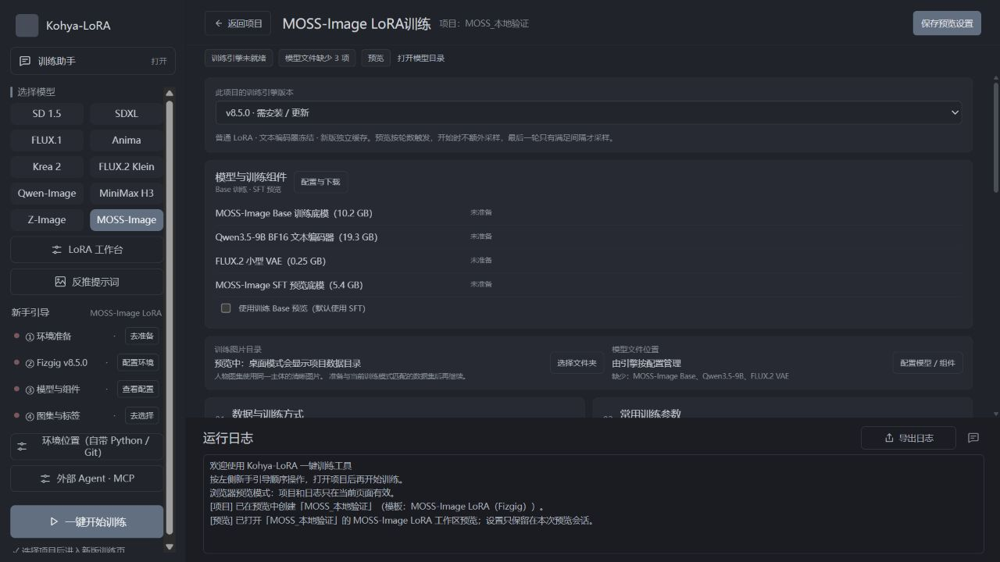

# MOSS-Image：Fizgig v8.5.0 接入与验证

日期：2026-10-18。**v0.19.13 功能验证记录**。源码接入、前端构建及 NVIDIA 8GB 小规模验证完成；发布信息见 [更新记录](../CHANGELOG.md)。

## 软件中的操作

1. 新建项目 → **MOSS-Image** → **MOSS-Image Base** → 人物、画风或概念。
2. 配置该项目的 **Fizgig v8.5.0**。其他模型和旧项目保留原先选择的引擎版本。
3. 在「模型与训练组件」中指定已有文件，或下载缺少的组件：
   - Base BF16 训练底模。
   - Qwen3.5-9B BF16 文本编码器；分片文件放在同一目录，选择其中一个分片即可。
   - FLUX.2 小型 VAE。
   - SFT INT8 ConvRot 预览底模：开启 SFT 预览时必需，关闭预览时可不下载。
4. 选择图片目录，检查标签，再训练。默认 Rank/Alpha 16、学习率 1e-4、重复 1、50 轮、512 分辨率、自动精度。

8GB 默认自动关闭训练中采样；可手动开启。预览额外占用显存和时间。默认使用 SFT，勾选「使用训练 Base 预览」后改用训练底模。

本次 2026-10-18 验证只覆盖普通 LoRA。2026-10-20 已在源码接入[多角色训练流程](MOSS_多角色训练说明.md)，尚未进行多人 GPU 训练和画质验收。概念滑块、LoKR、全量微调和其他上游工作台功能不在此入口的已验证范围。

截图中的「需安装」和「未准备」是浏览器演示状态；真实桌面状态由本机引擎和文件检查结果决定。

## 固定来源与环境

- Fizgig v8.5.0：`75d54881e466c9b7f436e2e397437a8bdc38f2e1`。
- 官方发布时间：2026-10-18 08:41:38（北京时间）。
- 源码归档 20,678,733 字节；SHA256：`71c9af3781c19e74ce8fe02bf04bc2561a13ea6cad8b43b3d5d0cdd1e1596ba5`。
- GPU：RTX 4070 Laptop，8188 MiB；系统内存约 32GB。
- 训练：独立 Python 3.12 环境，PyTorch 2.10.0+cu128、Transformers 4.57.6、bitsandbytes 0.48.2。借用已有依赖目录，不修改用户原训练环境。
- ComfyUI：原生 MOSS 支持提交 `e087d8f6cb7c6cdb11b59dc7c9bf17c79f8d877d`，独立核心目录和临时服务；Python 3.13、PyTorch 2.13.0+cu130。
- 原始 v8.5.0 源码保留在 `_tmp_moss_v850/source`；软件部署及补丁验证副本在 `_tmp_moss_v850/app_source`。

来源：[Fizgig v8.5.0](https://github.com/shootthesound/Fizgig/releases/tag/v8.5.0)、[原生 ComfyUI MOSS 支持](https://github.com/Comfy-Org/ComfyUI/pull/17095)。参数和行为以本次固定源码及真实启动日志为准。

## 8GB 实测

使用 3 张图片和真实描述测试缓存、反向传播、优化器更新、保存、续训及采样。测试夹具只在独立脚本中临时降低图集数量要求，软件正式要求不变。

| 阶段 | 设置和结果 |
| --- | --- |
| 文本缓存 | 完整精度 Qwen3.5-9B 逐层加载；3 条描述和空提示词缓存完成。首轮阶段总计 62.03 秒，整机显存峰值观测为 2489 MiB。 |
| 训练 | 自动选择 NF4、0 块交换；BS 1、Rank/Alpha 16、AdamW、固定学习率 1e-4、EMA 0.98；30 步完成。 |
| 稳定速度 | 预热后约 **1.47–1.51 秒/步**，训练器记录显存峰值约 **4.8GB**。 |
| 原始入口续训 | step 30 → 33，epoch 10 → 11，成功。 |
| 软件适配器流程 | 实际调用缓存和训练子进程：先完成 6 步，再增加总轮数，从 step 6 续训至 9；日志确认 `continuing at epoch 3/3`。 |
| SFT 预览 | SFT INT8 ConvRot、40 块交换、小型 VAE、512×512、30 步、CFG 4、种子 42；修复下述换块问题后正常生成彩色图片。 |
| 预览资源 | 整个测试阶段 243.69 秒，含编码、加载、3 步训练和采样；整机显存观测峰值 **7712 MiB**，不能当成单张纯采样耗时或进程独占显存。 |

**训练分辨率设置为 512，实际保比例桶为 352×496、352×512、384×512；速度不能直接外推到所有 512×512 图集。** 本次 v8.5.0 未重测 1024，短训练的编译自动策略未启用编译。这些结果证明流程可运行，不证明完整人物或画风拟合质量。

## 修复的问题

### SFT 预览的块交换

MOSS 第 22 块不挂 LoRA，其他块可包在 LoRALinear 中。上游交换代码按原始模块名匹配，两侧包装不同会查到没有 weight 的模块。第一处修复按逻辑名称匹配底层 Linear，保留适配器常驻策略。

此外，第 22 块为 BF16，邻块可为 INT8。原代码按形状复用存储，会把 BF16 参数变为 INT8。GPU 最小复现先得到 `block 22 dtype corrupted: torch.int8`，随后修复为：名称、形状或 dtype 不同时，先卸载旧块，再加载新块；同类型块仍使用原有快速交换路径。

验证包括固定随机输入、双向换块、固定/非固定内存和逐元素输出一致性检查；再运行完整模型 SFT 采样。补丁只应用到固定 v8.5.0 部署副本，并纳入源码哈希校验，不改写旧版本源码。

### 已完成项目错误地回退旧快照

原逻辑先丢弃最新的已完成快照，然后可能选中更早的未完成快照。现在先选最新的有效匹配状态，再判断是否已完成目标；提高总轮数后允许从最新状态继续。

自动化回归和真实软件适配器运行均覆盖：目标已完成时不提示回退、增加轮数后从最新状态继续、引擎版本不匹配时不混用快照。

## 原生 ComfyUI 导出验证

- 原生 UNETLoader、LoraLoaderModelOnly、MOSS 模型和 FLUX.2 小型 VAE，未修改 ComfyUI 核心代码或 LoRA 插件。
- Base BF16 文件在推理时转换为 FP8 e4m3 存储，以适应 8GB。
- 复用已验证的 Fizgig Qwen3.5 文本缓存，通过隔离测试节点送入条件；**未验证 ComfyUI 原生 Qwen3.5 加载器**。
- 512×512、res_multistep、simple、30 步、CFG 4、shift 5、跳过第 22 块的引导、种子 42。
- 164 个 patch 成功挂载；训练侧的 246 个模块与推理侧融合 QKV 映射不同，数量不要求相同。日志无 LoRA key 未加载警告。
- 修正工作流后两张图均为正常彩色人像，像素与哈希不同；整个验证含临时服务启动约 84.69 秒。

**验证中排除了一次错误结果：** 最初额外接入 ModelSamplingSD3，把原生 MOSS 的 timestep multiplier 从 1 改成 1000。服务执行成功但图片是噪点。移除该覆盖并复跑后才通过目视检查。错误结果保留为 `comfy_real_result_wrong_multiplier.json`，不计入通过结果。

| 底模 | 加载短训 LoRA |
| --- | --- |
|  |  |

两图用于证明 LoRA 加载和渲染链路，不能据此判定训练强度是否足够。

## 检查结果

| 检查 | 结果 |
| --- | --- |
| MOSS 后端集成 | 27 项通过 |
| 实际 GPU 换块回归 | 1 项通过；默认跳过，显式开启才运行 |
| 预览提示词回归 | 4 项通过 |
| 下载完整性回归 | 6 项通过 |
| 前端桥接 | 36 项通过 |
| v8.5.0 部署源码与 CLI | 固定源码哈希、train/cache 帮助入口、固定依赖版本检查通过 |
| Python 编译、前端类型检查及构建 | 通过；前端保留现有大于 500KB 的分包提示 |
| 浏览器界面 | 新建项目、版本提示、组件卡片、默认参数、不可用模式拦截和滚轮检查完成；控制台无 error |
| 差异格式检查 | 通过 |

旧 `test_modern_training.py` 测试集不是全绿：当前 26 项中 5 个失败、18 个错误；用 HEAD 版 modern_host 对照为 6 个失败、18 个错误。FakeCore 缺少接口、旧参数签名及无效模型夹具等基线问题仍存在。不能把本次定向通过表述为全仓测试通过。

训练日志中存在一条 Windows Triton/CUDA 探测线程的非致命编码警告；缓存、训练、续训和最终预览的退出状态及产物分别完成核对。

## 下载、兼容及交付边界

- 模型和分词器优先国内来源，失败后切换镜像或官方源。取消下载不会继续尝试其他来源，已有手动选择不会在选择框取消时被覆盖。
- 本机补齐的 SFT 来自 ModelScope；小型 VAE 当时魔搭未同步，使用 hf-mirror。新模型已完成文件哈希核对。
- v8.5.0 源码归档与固定分词器文件通过软件的 ModelScope 国内镜像分发；下载校验采用上文固定大小和 SHA256。
- 旧项目的 v6.5.0、v7.0.1、v7.3.1 选择保留；MOSS 独立使用 v8.5.0，不强制其他模型升级。
- AMD 实机、v8.5.0 的 1024 持续训练、完整图集拟合质量和从零安装仍待验证。
- 本页的功能实测基于源码适配器；安装包校验与发布流程单独执行，不能替代上述 GPU 与质量验证。

## 证据位置

- 稳定归档：[结构化结果](assets/moss-v850/validation.json)、本页截图和采样图。
- 原始记录：`_tmp_moss_v850/source_metadata.json`、`validation_status.json`、`train_auto_512.log`、`sft_preview_fixed_512.log`。
- 软件真实调用：`_tmp_moss_v850/app_flow/result.json` 和该目录的各阶段日志。
- ComfyUI：`_tmp_moss_v850/comfy_real_result.json`、`comfy_real_validation.log`、`comfy_validation_api.json`。
- 测试：`tests/test_moss_integration.py`、`tests/test_moss_offloading_gpu.py`。

已下载的模型可在组件选择中直接复用，不必重复下载。
